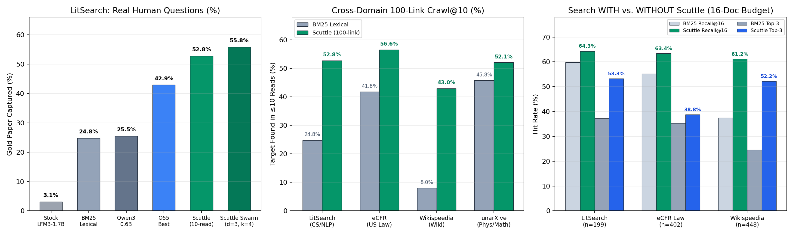
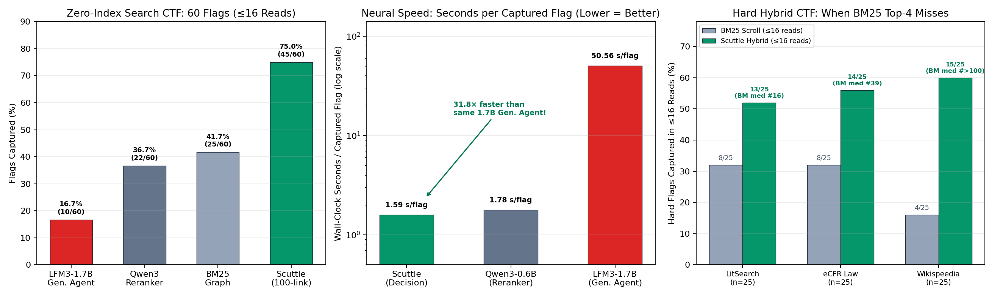

# Scuttle

**Frontier-calibrated 1.7B decision model & MCP server for fast parallel swarm search over linked document graphs.**

> *Like crawling, but faster.*

[](https://huggingface.co/Multiqueue/scuttle-1.7b)
[](https://github.com/MLTQ/scuttle-demos)
[](LICENSE)
[](https://huggingface.co/Multiqueue/scuttle-1.7b/blob/main/LICENSE)

**Scuttle** gives AI agents fast, calibrated "search intuition" over linked corpora—scientific citation graphs, statutory legal codes, wikis, and Markdown/Obsidian vaults. Instead of running slow autoregressive LLM loops on every hop, Scuttle runs a **single backbone forward pass** (`LFM3-1.7B` + 15 KB of fp32 decision heads, zero text generation) to simultaneously output:

1. **$P(\text{page contributes} \mid q, \text{page})$** — a calibrated relevance probability (`0.949` AUC).
2. **$P(d \le k \mid q, \text{link})$ for $k \in \{0,1,2,3,4,6\}$** across up to **100 links at once** — calibrated frontier priorities for a shared best-first parallel swarm.

On an RTX 4090 in **4-bit NF4**, Scuttle uses just **1.70 GiB static VRAM** (**0.0 GiB idle** with `--idle-offload`), retains **100.0% of BF16 search accuracy**, and finishes a full multi-hop swarm search in **~1.2–1.6 seconds**.

---

## Highlights & Benchmarks



### 1. Search CTF Speed Run (60 Zero-Index Flags, ≤16 Reads, Warm RTX 4090)



| Method | Flags Captured | Solve Rate | Latency / Run | **Seconds / Captured Flag** |
| --- | ---: | ---: | ---: | ---: |
| **Scuttle** *(100-link decision model)* | **45 / 60** | **75.0%** | **1.19 s** | **1.59 s / flag** |
| `Qwen3-Reranker-0.6B` *(24-link neural)* | 22 / 60 | 36.7% | 0.65 s | 1.78 s / flag |
| `LFM3-1.7B` Generative Agent *(same 1.7B weights)* | 10 / 60 | 16.7% | 8.43 s | 50.56 s / flag |
| BM25 Graph *(CPU lexical)* | 25 / 60 | 41.7% | 0.02 s | 0.04 s / flag |

- **vs. Same 1.7B Model as a Generative Agent:** **7.1× faster/run**, **4.5× more captures**, **31.8× faster per captured flag**.
- **vs. `Qwen3-Reranker-0.6B`:** **2.05× more captures** while scoring 4× wider link menus (100 vs. 24 links).

### 2. Controlled With vs. Without Scuttle (1,049 Queries, Exact Same 16-Doc Budget)

| Domain | Queries | Recall@16: BM25 → **Scuttle** | Top-3: BM25 → **Scuttle** | **BM25 Miss Recovery** |
| --- | ---: | :---: | :---: | ---: |
| **LitSearch** (CS/NLP citations) | 199 | 59.8% → **64.3%** (+4.5) | 37.2% → **53.3%** (+16.1) | **26 / 80 (32.5%)** |
| **eCFR** (US Federal Law) | 402 | 55.2% → **63.4%** (+8.2, $p{=}0.0008$) | 35.3% → **38.8%** (+3.5) | **63 / 180 (35.0%)** |
| **Wikispeedia** (Masked topics) | 448 | 37.5% → **61.2%** (+23.7, $p{<}10^{-20}$) | 24.6% → **52.2%** (+27.7) | **121 / 280 (43.2%)** |
| **Combined** | **1,049** | **48.5% → 62.6% (+14.1 pts)** | **31.1% → 47.3% (+16.2 pts)** | **210 / 540 (38.9%)** |

### 3. Low-VRAM Quantization (BF16 vs. 8-Bit vs. 4-Bit NF4)

| Precision | Static VRAM | Peak VRAM (100-link) | 60-Flag CTF Solved | Retention | Latency / Run | Page AUC / F1 |
| --- | ---: | ---: | ---: | ---: | ---: | ---: |
| **BF16** | 3.22 GiB | 3.99 GiB | 45 / 60 (75.0%) | 100.0% | 1,491 ms | 0.9546 / 0.7379 |
| **8-bit** (`LLM.int8`) | 2.40 GiB | 3.89 GiB | 44 / 60 (73.3%) | 97.8% | 1,905 ms | 0.9565 / 0.7475 |
| **4-bit NF4** *(recommended)* | **1.70 GiB** | **3.02 GiB** | **45 / 60 (75.0%)** | **100.0%** | **1,564 ms** (+4.9%) | **0.9534 / 0.7523** |

> **Recommendation:** Use `--quant 4bit` (plus `--idle-offload 120` for MCP). It cuts static VRAM nearly in half, runs faster than 8-bit, matches BF16 CTF accuracy 100%, and frees **100% of VRAM (`0.0 GiB`)** when idle.

Read the full technical report in **[WHITEPAPER.md](WHITEPAPER.md)**.

---

## Installation

```bash
# With 4-bit / 8-bit quantization support (recommended):
pip install "scuttle-search[quant] @ git+https://github.com/MLTQ/scuttle.git"

# Or BF16 / CPU only (no bitsandbytes):
pip install "scuttle-search @ git+https://github.com/MLTQ/scuttle.git"
```

Weights auto-download on first run from Hugging Face: [`Multiqueue/scuttle-1.7b`](https://huggingface.co/Multiqueue/scuttle-1.7b).

---

## Quickstart

### 1. Index any folder of Markdown, Obsidian, or HTML files

```bash
scuttle index ./my-notes-or-docs -o docs-graph.json.gz --domain notes --noun note
```

`scuttle index` automatically parses `[[wikilinks]]`, `[markdown](links.md)`, and HTML `<a href>` links along with the surrounding citation sentence.

Or grab ready-to-run real-world graphs (**US Federal Law eCFR** + **Wikispeedia** + **sample Markdown vault**) from the companion demo repo: **[`MLTQ/scuttle-demos`](https://github.com/MLTQ/scuttle-demos)**.

### 2. Run a Swarm Search from the CLI

```bash
scuttle search \
  --graph docs-graph.json.gz \
  --query "exemption from registration for private securities offerings to accredited investors" \
  --quant 4bit \
  --budget 16
```

### 3. Use as a Python Library

```python
from scuttle import load_world, ScuttleSearcher

world = load_world("ecfr-law-graph.json.gz")
searcher = ScuttleSearcher(world, model="Multiqueue/scuttle-1.7b", quant="4bit")

result = searcher.search(
    "exemption from registration for private securities offerings to accredited investors",
    n_seeds=4,
    budget=16,
)

for hit in result["contributing"]:
    trail = " -> ".join(t["title"] for t in hit["trail"])
    print(f"[{hit['p_contributes']:.3f}] {hit['title']}\n  Trail: {trail}")
```

---

## AI Agent Integration (MCP Server)

`scuttle-mcp` is a zero-bloat JSON-RPC 2.0 stdio MCP server that keeps Scuttle warm for ~1s queries and automatically evicts VRAM when idle (`--idle-offload`).

Drop this into your MCP config (**Antigravity**, **Claude Code**, **Cursor**, **Codex**, etc.):

```json
{
  "mcpServers": {
    "scuttle": {
      "command": "scuttle-mcp",
      "args": [
        "--quant", "4bit",
        "--idle-offload", "120",
        "--graphs", "/path/to/your/graphs"
      ]
    }
  }
}
```

**Exposed MCP tools:**
- `scuttle_search(graph, query, seeds=4, budget=16, start_ids=None, threshold=0.45)` — returns ranked contributing docs, calibrated `p_contributes`, exact hop-by-hop provenance trails, and latency.
- `scuttle_index_directory(directory, output_path, domain="docs", doc_noun="document")` — builds a Scuttle graph from local Markdown/HTML/text files on the fly.
- `scuttle_list_graphs()` — lists registered `.json.gz` graphs in `--graphs`.

---

## Custom Graph Schema (`graph.json.gz`)

Any corpus can be searched by Scuttle if exported to this minimal JSON (or gzipped JSON) format:

```json
{
  "domain": "my-corpus",
  "doc_noun": "document",
  "papers": {
    "doc_1": {
      "title": "Section 506 — Private Offerings",
      "abstract": "First ~700 chars of document text or summary..."
    }
  },
  "out": {
    "doc_1": [
      ["doc_2", "Optional sentence where doc_1 cites or links to doc_2."]
    ]
  }
}
```

Incoming edges are automatically inverted on load, and `ScuttleWorld` builds flexible up-to-100-link menus (`60 out + 40 in` with unused slot rollover).

---

## Licenses

- **Code (`MLTQ/scuttle`):** [MIT License](LICENSE).
- **Model Weights (`Multiqueue/scuttle-1.7b`):** Derived from Liquid AI's `LFM3-1.7B` and distributed under the **[LFM Open License v1.0](https://huggingface.co/Multiqueue/scuttle-1.7b/blob/main/LICENSE)** (free for research, non-commercial, and commercial use under \$10M annual revenue).
