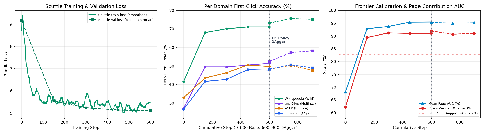
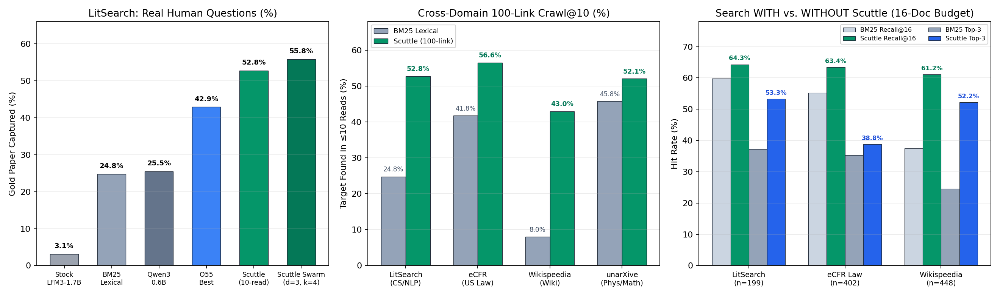
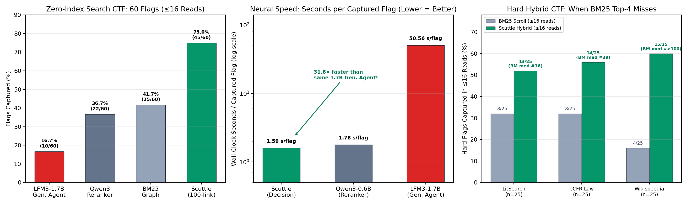

# Scuttle: Frontier-Calibrated Search Intuition for Fast Parallel Swarm Graph Navigation

**Abstract.** We introduce **Scuttle**, a 1.7B-parameter single-pass decision model (`LFM3-1.7B` backbone with 15 KB of learned fp32 decision heads and zero autoregressive decoding) trained to navigate linked document graphs—scientific citations, US federal regulations, and Wikipedia hyperlinks—as a parallel swarm over poorly indexed corpora. Starting from a quantitative audit of prior attempts (`SerMod` and `O55`), we isolate three root causes that capped earlier models at ~41–43% on LitSearch: (1) single-logit compression (`0.8^d`) crushing direct hits (`d=0`) into 1-hop links (`d=1`), (2) a `d_page` context halo driven by shift-invariant per-menu ranking losses, and (3) severe graph-truncation label noise (`K_IN=12` dropping 51.8% of incoming edges). Fixing all three via **decoupled cumulative ordinal distance heads** ($P(d \le k)$), **request-grouped multi-menu frontier training**, **flexible 100-link menus**, and **100-link multi-domain on-policy DAgger** across 4 domains (255,575 documents; 4.05M verified link labels) yields a single unified checkpoint ([`Multiqueue/scuttle-1.7b`](https://huggingface.co/Multiqueue/scuttle-1.7b)) that reaches **52.8%** 10-read LitSearch crawl success (**55.8%** in 4-seed 3-hop parallel swarms, +17.1 pts over O55 DAgger), **56.6%** on US Federal Law (eCFR), and **43.0%** on Wikispeedia (**5.4× BM25**). In a **60-flag Zero-Index Search CTF Speed Run** on an RTX 4090, Scuttle captures **75.0% (45/60)** of hidden flags in **1.19 s/run** (**1.59 s/captured flag**)—**7.1× faster per run, 4.5× more captures, and 31.8× faster per captured flag** than prompting the exact same 1.7B model as a generative agent (`16.7%`, `8.43 s/run`, `50.56 s/flag`), and **2.05× more captures** than `Qwen3-Reranker-0.6B` (`36.7%`, `1.78 s/flag`). In **4-bit NF4 double-quantization**, Scuttle drops static VRAM from **3.22 GiB to 1.70 GiB** while retaining **100.0%** of its BF16 CTF solve rate (`45/60`). In a controlled **1,049-query With vs. Without Scuttle** benchmark at an identical 16-document read budget, Scuttle rescues **38.9% (210/540)** of total lexical BM25 misses while beating BM25 on Recall@16 across every domain (+4.5 pts LitSearch, +8.2 pts US Federal Law $p = 8.1 \times 10^{-4}$, +23.7 pts Wikispeedia $p < 10^{-20}$).

---

## 1. Motivation & Diagnosis of Prior Plateaus

Large document collections such as ArXiv, statutory legal codes, and internal wikis are often poorly indexed for conceptual or multi-hop queries, yet richly linked by citations and cross-references. Rather than running slow autoregressive reasoning loops at every hop, **Scuttle** frames link navigation as a **pure single-pass decision problem**: given a query, the current document, and up to 100 visible links, one backbone forward pass outputs (a) a calibrated probability that the current document contributes to the answer and (b) calibrated frontier priorities for every link, enabling a harness to dispatch a parallel swarm over a shared best-first frontier.

Auditing prior checkpoints (`lfm3-pilot`, `lfm3-menu`, `lfm3-dagger`, `lfm3-back`) on the 64,183-paper LitSearch citation graph exposed three quantitative root causes behind their ~35% first-click / ~41–43% crawl ceiling:

1. **Direct-hit compression (`GAMMA = 0.8`):** On validation states, `lfm3-menu` separated the target page (`d=0`) from `d=1` by **3.86 logits** on its page readout (`+1.29` vs. `-2.57`, AUC 0.947), yet separated a direct link to the target (`d=0`) from `d=1` links by only **0.44 logits** (`+1.21 ± 0.94` vs. `+0.76 ± 0.50`). Because $0.8^1 = 0.80$ sits close to $0.8^0 = 1.00$ and `d=1` links outnumber `d=0` links 14:1, cross-menu `d=0` vs. `{1,2,3}` concordance sat at only **78.6%**, leaving ~100 direct target links skipped on the frontier.
2. **The `d_page` context halo:** Holding destination distance fixed at `d=2`, `lfm3-menu` scored links at **`+0.37`** when sitting on a `d_page=1` page vs. **`+0.05`** from a `d_page=3` page—so a `d=2` link on a `d=1` page (`+0.37`) outscored a `d=1` link on a `d=2` page (`+0.35`). Shift-invariant per-menu listwise cross-entropy allowed entire menus to drift up or down depending on the current page's topicality.
3. **Menu-cap label corruption & unobservable `Go back` oracle:** Capping menus at `K_OUT=12, K_IN=12` dropped **51.8%** of incoming citation edges, flipping **52.7%** of visible link distances on LitSearch dev forks (49.8% false negatives on truly closer links). Separately, `O55` Run 3 (`lfm3-back`) collapsed from 21.8% to 2.5% because its `Go back` action was labeled with the zero-cost global stack minimum (optimal 74% of the time, tied 18%) while hiding unread parent links from context.

---

## 2. Scuttle Architecture, Loss, and Multi-Domain Data

### 2.1 Single-Pass Distributional Decision Heads (`scuttle/model.py`)
Scuttle runs `LFM3-1.7B` purely as a backbone (`self.lm.model(...)`, **no text generation and no 128k-vocab `lm_head` forward pass**). Because 18 of LFM3-1.7B's 24 layers are linear $O(N)$ (`13 conv + 5 sliding_attention`) with only 6 full-attention layers and a 262K context window, single-pass scoring over 100-link menus runs in ~100 ms on an RTX 4090.

At the page and link readout positions we attach two lightweight fp32 linear heads (~15 KB total):
- **`page_head` ($\mathbb{R}^{2048} \to \mathbb{R}^1$):** calibrated probability $P(\text{page contributes} \mid q, \text{page})$.
- **`link_head` ($\mathbb{R}^{2048} \to \mathbb{R}^6$):** six independent cumulative ordinal logits predicting
  $$p_k = P(d \le T_k \mid q, \text{link}), \quad T = (0, 1, 2, 3, 4, 6).$$

Giving each threshold its own learned direction in hidden space lets Scuttle cleanly separate *"this IS the target ($d=0$)"* from *"this is a strong 2-hop bridge ($d \le 2$)"*. All head weights initialize along stock LFM3's pretrained `w[" yes"] - w[" no"]` direction with step-0 empirical log-odds bias calibration and matched weight LR (`5e-6`, scalar bias LR `1e-3`).

Frontier priority is composed via exact Abel summation over rewards $r = (1.00, 0.50, 0.28, 0.16, 0.09, 0.04, 0.00)$:
$$V(p) = \sum_{k=0}^{5} c_k p_k, \quad c = (0.50, 0.22, 0.12, 0.07, 0.05, 0.04),$$
dedicating **50% of the entire priority scale purely to $d=0$ vs. $d \ge 1$**.

### 2.2 Multi-Menu Bundle Packing, 100-Link Menus & Balanced On-Policy DAgger
- **Multi-menu bundle loss:** Every training step packs complete 6-state request bundles (`d ∈ {0, 1, 2, 3, 4–6, >6}`) across all 4 domains (`litsearch:2, unarxive:1, wiki:1, ecfr:1`) with exact two-pass gradients (verified `<1e-5` vs. one-pass):
  $$\mathcal{L} = 1.0\,\mathcal{L}_{\text{page}} + 2.0\,\mathcal{L}_{\text{ord}} + 1.0\,\mathcal{L}_{\text{frontier}} + 0.5\,\mathcal{L}_{\text{menu}},$$
  where $\mathcal{L}_{\text{ord}}$ weights $k=0$ symmetrically $2.0\times$ (sharpening $P(d=0)$ without distorting calibration) and $\mathcal{L}_{\text{frontier}}$ applies listwise CE over $\tau V(p)$ ($\tau = 8$) pooled across **all non-target menus of the request simultaneously**—directly eliminating the `d_page` halo.
- **Flexible 100-link menus (`scuttle/world.py`):** Takes up to 60 outgoing links first, fills remaining slots up to 100 with top incoming links, then fills any remaining budget with leftover outgoing links. Adaptive snippet compaction keeps worst-case 100-link hubs under ~7,500 tokens (`17.5–18.5 GiB` peak VRAM during training on an RTX 4090). All labels use **true uncapped graph distances**.
- **Balanced 100-link Multi-Domain DAgger:** 2 rounds × 150 steps rolling out 1,280 live 100-link crawls across all 4 domains to suppress false-positive hub spikes on large frontiers, paired with fresh offline replay bundles so `P(page contributes)` stays sharply calibrated.

### 2.3 Four-Domain Verification Corpus (0 Label Mismatches)

| Domain | Link Type | Documents | Edges | Train Bundles (States) | 100-Link Labels | BFS Verify |
| --- | --- | ---: | ---: | ---: | ---: | --- |
| **LitSearch** (CS/NLP) | Citation graph | 64,183 | 366,504 | 18,635 (111,809) | 1,861,943 | 0 mismatches |
| **unarXive** (Phys/Math/CS/Bio) | Citation graph (gold-excluded) | 164,909 | 35,802 | 3,098 (18,332) | 98,028 | 0 mismatches |
| **Wikispeedia** ("6 degrees") | Wikipedia hyperlinks | 4,604 | 119,772 | 9,912 (54,472) | 1,847,201 | 0 mismatches |
| **eCFR** (US Federal Law) | Statutory `§` cross-refs (6 CFR titles) | 21,879 | 21,438 | 6,508 (38,965) | 242,047 | 0 mismatches |
| **Total** | **4 distinct graph topologies** | **255,575** | **543,516** | **38,153 (223,578)** | **4,049,219** | **0 mismatches** |

---

## 3. Training Convergence

Training converged cleanly with **zero overfitting**: training and 4-domain validation bundle losses track together from `~9.2` down to **`5.107`** by steps 450–600. Mean **Page AUC** across all 4 domains locked in at **`95.4%`** (`97.4%` LitSearch, `98.6%` Wiki), and cross-menu `d=0` target concordance stabilized at **`91–93%`** (vs. prior O55 DAgger's `82.7%`). On-policy 100-link DAgger (steps 600–900) further lifted first-click accuracy across Wikipedia (`71.1% → 75.2%`) and unarXive (`51.5% → 58.3%`) while eliminating large-frontier distractor spikes.

---

## 4. Benchmark Results

### 4.1 Multi-Domain Graph Navigation & Parallel Swarm

| Worker | LitSearch Crawl@10 (`12+12`) | LitSearch Crawl@10 (`100`-lnk) | Swarm `d=3, k=4` (`100`-lnk, 16 reads) | eCFR US Law (`100`-lnk, 804 forks) | Wikispeedia (`100`-lnk, 896 forks) | unarXive (`100`-lnk, 96 forks) | Test Page AUC / F1 |
| --- | ---: | ---: | ---: | ---: | ---: | ---: | ---: |
| BM25 Lexical | 24.8% | — | — | 41.8% | 8.0% | 45.8% | — |
| Stock LFM3-1.7B | 3.1% | — | — | — | — | — | 0.683 / — |
| Stock Qwen3-Reranker-0.6B | 25.5% | — | — | — | — | — | 0.887 / — |
| O55 Best (`menu` / `dagger`) | 42.9% | — | 38.7% *(12+12)* | — | — | — | 0.947 / — |
| **Scuttle** (`Multiqueue/scuttle-1.7b`) | **44.8%** | **52.8%** (`d3`: 41.7%) | **55.8%** (`91/163`) | **56.6%** (`d3`: 46.3%) | **43.0%** (`51.9%` click) | **52.1%** (`d2`: 75.0%) | **0.949 / 0.748** |

**Important negative finding on frontier aggregation:** Boosting frontier nodes linked by multiple parallel swarm seeds via noisy-OR (`agg="conv"`) *hurt* `d=3, k=4` swarm recall by **−9.8 points** (`55.8% → 46.0%`). In scale-free citation graphs, all 4 seeds cite generic mega-hubs (*BERT*, *Transformer*, *Adam*), so naive multi-path boosting traps the swarm in hubs. Calibrated **`agg="max"`** lets whichever branch caught the specific target scent win immediately.

### 4.2 Controlled Benchmark: Search WITH vs. WITHOUT Scuttle (Exact Same 16-Doc Budget)

Comparing **Without Scuttle** (full-corpus BM25 opening the top 16 documents) against **With Scuttle** (BM25 top-4 seeds + 12 parallel Scuttle hops, opening the exact same 16 documents and ranking them by calibrated `P(page contributes)`):

| Domain | Queries ($n$) | Recall@16: BM25 → **Scuttle** | Sign Test $p$ | Top-3: BM25 → **Scuttle** | Top-1: BM25 → **Scuttle** | **BM25 Miss Recovery** *(rescued when BM25 missed all top-16)* |
| --- | ---: | :---: | ---: | :---: | :---: | ---: |
| **LitSearch** (Human CS/NLP) | 199 | 59.8% → **64.3%** (+4.5 pts) | 0.222 | 37.2% → **53.3%** (+16.1, $p{=}10^{-6}$) | 25.1% → **39.2%** (+14.1, $p{=}6{\times}10^{-5}$) | **26 / 80 (32.5%)** |
| **eCFR** (US Federal Law) | 402 | 55.2% → **63.4%** (+8.2 pts) | **0.00081** | 35.3% → **38.8%** (+3.5) | 21.1% → 16.9% (−4.2, $p{=}0.08$) | **63 / 180 (35.0%)** |
| **Wikispeedia** (Masked Topics) | 448 | 37.5% → **61.2%** (+23.7 pts) | **$<10^{-20}$** | 24.6% → **52.2%** (+27.7, $p{<}10^{-20}$) | 17.0% → **38.8%** (+21.9, $p{<}10^{-20}$) | **121 / 280 (43.2%)** |
| **Combined** | **1,049** | **48.5% → 62.6% (+14.1 pts)** | — | **31.1% → 47.3% (+16.2 pts)** | **20.1% → 30.5% (+10.4 pts)** | **210 / 540 (38.9%)** |

As queries become less lexically direct—from LitSearch to cross-referenced Federal Statutes to masked-topic Wikipedia—Scuttle's Recall@16 advantage scales from **+4.5 → +8.2 → +23.7 points**, rescuing **38.9%** of all queries where BM25 failed completely.

---

## 5. Search CTF Speed Runs: How Much Faster Is Scuttle?

We raced **Scuttle** head-to-head against three competing search methods on the **exact same RTX 4090** across two Capture-the-Flag tracks:

### Track A: Zero-Index 60-Flag CTF Speed Run (20 LitSearch + 20 US Law + 20 Wiki, ≤16 Reads)

| Competitor | Flags Captured | Solve Rate | Mean Reads (hit) | Latency / Run | **Seconds / Captured Flag** | LS / Law / Wiki |
| --- | ---: | ---: | ---: | ---: | ---: | --- |
| **Scuttle** *(100-link decision model)* | **45 / 60** | **75.0%** | 6.98 | **1.19 s** (`1,194 ms`) | **1.59 s / flag** | **15/20 · 17/20 · 13/20** |
| **Qwen3-Reranker-0.6B** *(24-link neural)* | 22 / 60 | 36.7% | 7.27 | 0.65 s | 1.78 s / flag | 5/20 · 11/20 · 6/20 |
| **LFM3-1.7B Generative Agent** *(same 1.7B weights, autoregressive)* | 10 / 60 | 16.7% | 4.10 | **8.43 s** (`8,427 ms`) | **50.56 s / flag** | 1/20 · 8/20 · 1/20 |
| **BM25 Graph** *(CPU lexical)* | 25 / 60 | 41.7% | 6.60 | 0.017 s | 0.04 s / flag | 8/20 · 13/20 · 4/20 |

- **vs. Same 1.7B Model as a Generative Agent:** Scuttle is **7.1× faster per run**, captures **4.5× more flags** (`75.0%` vs. `16.7%`), and is **31.8× faster per captured flag** (`1.59 s` vs. `50.56 s`).
- **vs. `Qwen3-Reranker-0.6B`:** Scuttle captures **2.05× more flags** (`75.0%` vs. `36.7%`; **3× more on LitSearch**) while running **11% faster per captured flag** even while evaluating **4× wider link menus (100 vs. 24)**.

### Track B: Hard Hybrid CTF (75 Hard Flags Where BM25 Top-4 Missed, 25/Domain)

| Domain (25 hard flags each) | BM25 Scroll (≤16 reads) | **Scuttle Hybrid (≤16 reads)** | Scuttle Avg Time / Reads | BM25 Median Rank on Scuttle Captures | Invisible in BM25 Top-100 |
| --- | ---: | ---: | ---: | ---: | ---: |
| **LitSearch** | 8 / 25 (32%) | **13 / 25 (52%)** | 3.50 s / 7.08 reads | Rank **#16** | 4 / 13 |
| **eCFR US Federal Law** | 8 / 25 (32%) | **14 / 25 (56%)** | **0.92 s** / 7.86 reads | Rank **#39** (~5× fewer docs!) | 2 / 14 |
| **Wikispeedia** | 4 / 25 (16%) | **15 / 25 (60%)** | 4.31 s / 7.00 reads | Rank **#>100** | 9 / 15 |
| **Total (75 hard flags)** | **20 / 75 (26.7%)** | **42 / 75 (56.0% — 2.1×)** | — | — | **15 / 42 (35.7%)** |

On US Federal Law, Scuttle solves hard cross-referenced queries in **0.92 seconds** and **7.9 reads** where scrolling flat BM25 requires a median of **39 documents** (~5× fewer documents opened). Across all 75 hard flags, **35.7% of Scuttle's captures didn't even appear in BM25's top 100 results**.

---

## 6. Low-VRAM Quantization Benchmark (BF16 vs. 8-Bit vs. 4-Bit NF4)

Because local GPUs are often shared with larger reasoning LLMs, we evaluated Scuttle (`tie_word_embeddings=true`, 15 KB fp32 decision heads) across full **BF16**, **8-bit (`bitsandbytes` LLM.int8)**, and **4-bit NF4 double-quantization (`bnb_4bit_compute_dtype=bf16`)** on the exact same 60-flag Zero-Index CTF suite and 300-example O55 Page Head test slice:

| Precision | Static VRAM | Peak VRAM (100-link) | 60-Flag CTF Solved | Solve Retention | Mean Latency / Run | Page Head AUC (300) | Page Head F1 (300) |
| --- | ---: | ---: | ---: | ---: | ---: | ---: | ---: |
| **BF16** (reference) | 3.22 GiB | 3.99 GiB | 45 / 60 (75.0%) | 100.0% | 1,491 ms | 0.9546 | 0.7379 |
| **8-bit** (`LLM.int8`) | 2.40 GiB | 3.89 GiB | 44 / 60 (73.3%) | 97.8% | 1,905 ms | **0.9565** | 0.7475 |
| **4-bit NF4** *(double-quant)* | **1.70 GiB** | **3.02 GiB** | **45 / 60 (75.0%)** | **100.0%** | **1,564 ms** (+4.9%) | 0.9534 | **0.7523** |

**Key finding:** **4-bit NF4 double-quantization is strictly superior to 8-bit** on every practical axis—cutting static VRAM nearly in half (**3.22 → 1.70 GiB**, −47%), retaining **100.0% of BF16 CTF solve rate** (`45/60`, LS 15/20 · Law 16/20 · Wiki 14/20), matching Page AUC (`0.9534`) with slightly higher F1 (`0.7523`), and running within **4.9%** of BF16 latency (`1,564 ms` vs. `1,491 ms`, faster than 8-bit's `1,905 ms`). Paired with `scuttle-mcp --quant 4bit --idle-offload 120`, Scuttle consumes **1.70 GiB static VRAM** during active swarm bursts and **0.0 GiB VRAM** while idle.

---

## 7. Live Agent Tool Traces

Running `scuttle search` live (4 BM25 seeds + 8 swarm hops = 12 reads):

- **US Federal Law (`eCFR`):** *"exemption from registration for private securities offerings to accredited investors"*
  - `[0.676] 17 CFR § 230.215 (Accredited investor)` via `§ 230.163B → § 230.501 (Definitions) → § 230.215`
  - `[0.676] 17 CFR § 230.241 (Solicitations of interest)` via `§ 230.506 (Limited offers) → § 230.502 (General conditions) → § 230.241`
- **Scientific Literature (`LitSearch`):** *"methods to compress large-scale language models using task-agnostic knowledge distillation"*
  - Surfacing `GKD` (`0.977`), `XtremeDistil` (`0.941`), and discovering via 1–2 citation hops `MINILMv2` (`0.668`, via `XtremeDistil → MINILMv2`) and `MIXKD` (`0.871`, via `Contrastive Distillation → Rethinking Task-Specific KD → MIXKD`).

---

## 8. Limitations & Practical Next Steps

- **Legal Top-1 reranking nuance:** On eCFR, Scuttle lifted Recall@16 by **+8.2 pts** ($p = 0.00081$) and Top-3 by +3.5 pts, while Top-1 trailed BM25 slightly (`16.9%` vs. `21.1%`, $p = 0.08$) due to shared statutory boilerplate in the 700-char opening snippet. Combining `p_contributes` with a small BM25 tie-breaker or reading deeper into legal sections is a direct next win.
- **Untouched LitSearch holdout:** All LitSearch evaluations used the 1/3 development split; the remaining 2/3 holdout remains untouched for any final external publication claim.
- **Plugging in custom corpora:** Any linked corpus (e.g., IRS Title 26, full ArXiv, Obsidian vaults, internal docs/wikis) works out of the box via `scuttle index <dir> -o graph.json.gz` or by exporting to the minimal `graph.json.gz` schema (`papers` + `out` edges).
